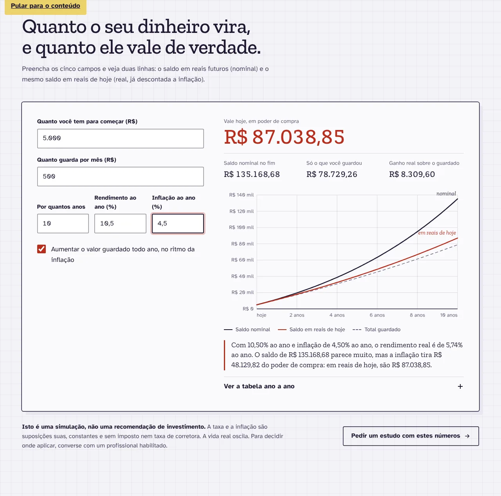

# Marginal Estudos Econômicos (demonstração)

Oi, eu sou o Rodrigo Jr, da [Mil e Uma Linhas!](https://mileumalinhas.com.br). Este site é uma **demonstração** que eu fiz para mostrar a economistas, consultores e analistas financeiros o que um site de verdade pode fazer por eles. A empresa, a economista, o endereço, o telefone, os preços e os números do termômetro são **inventados**. Nada aqui é vendido, cobrado ou enviado.

Endereço quando publicado: https://toshiro01001.github.io/economista/

## O que o site é

Um site de uma economista independente fictícia em Cuiabá. Ele não só apresenta os serviços: ele deixa o visitante **testar** três ferramentas e pedir um estudo, tudo na própria página.

## Como usar, em passos

1. Abra o site. Em "O que eu faço" estão os quatro serviços.
2. Em **Juros e inflação**, preencha o quanto tem, o quanto guarda por mês, o prazo, o rendimento e a inflação. O gráfico mostra o saldo nominal e o saldo em reais de hoje.
3. Em **Financiamento**, informe valor, entrada, prazo e juros. Veja as duas tabelas, Price e SAC, com gráfico e tabela de parcelas.
4. No **Termômetro**, escolha o período e a série (inflação, juros ou câmbio). Todos os números são inventados.
5. Em **Pedir um estudo**, preencha o formulário. O resumo aparece na tela. Nada é enviado.

## Capturas

| Computador | Celular |
|---|---|
|  |  |
|  |  |
|  |  |
|  |  |
|  |  |

## Identidade visual, em resumo

Pensei no universo de quem trabalha com economia: papel quadriculado, quadro de giz, lápis vermelho de correção e régua de escala logarítmica. Nada de moeda dourada, azul de banco ou gráfico subindo para sempre.

- **Cores:** papel lilás claro `#F3F2F7`, tinta violeta `#1F1830`, quadro de giz ameixa `#2B2339`, giz amarelo `#EBD36B` e um único destaque, o lápis vermelho `#B82E1D`.
- **Fontes:** Zilla Slab (títulos e números, com cara de caderno de séries) e Atkinson Hyperlegible (texto, feita para ler fácil). As duas são livres (SIL OFL) e ficam na pasta `fonts/`.
- **Movimento:** só um, na abertura: a régua logarítmica é "puxada" da esquerda para a direita.
- Estudo completo, com o prompt da foto definitiva do hero, em [`docs/identidade.md`](docs/identidade.md).

## Como funciona por dentro

Seu navegador faz todas as contas sozinho. O simulador calcula mês a mês: aplica o rendimento, soma o que você guardou e desconta a inflação para dizer quanto aquele dinheiro compra em reais de hoje. O comparador monta as tabelas Price (parcela fixa) e SAC (amortização fixa, parcela caindo). O termômetro lê três séries inventadas guardadas num arquivo e desenha a do período escolhido. O pedido confere os campos e mostra o resumo. Nada sai do navegador e nada fica guardado.

## Detalhes técnicos

- HTML, CSS e JavaScript puros, sem framework, sem CDN, sem analytics.
- `index.html` (página única com âncoras), `404.html`, `css/estilo.css`, `js/calculos.js` (contas), `js/graficos.js` (gráficos de linha em SVG, redesenhados quando a largura muda), `js/dados.js` (séries fictícias, semente 430), `js/app.js` (tela), `img/` (foto provisória do hero, régua em SVG), `fonts/`.
- Juros compostos com taxa mensal equivalente `(1+i)^(1/12)-1`, aporte no fim do mês, aporte corrigido pela inflação uma vez por ano (opcional) e valor real `nominal / (1+inflação mensal)^meses`.
- Price: `PMT = PV*i / (1-(1+i)^-n)`. SAC: amortização `PV/n` e juros sobre o saldo.
- `img/hero.webp` é uma foto gerada por IA no Canva (1620x1080), feita a partir do prompt de `docs/identidade.md`.

## Como rodar

Não precisa instalar nada. Na pasta acima deste projeto:

```
python3 -m http.server 8320
```

e abra http://127.0.0.1:8320/economista/ no navegador.

## Testes

Com o Playwright instalado, na raiz do projeto: `node tests/site.cjs`. O script sobe o servidor, abre o site em 1280x900, iPhone 13 e 320px, confere as contas (casos com resposta conhecida), as validações, o termômetro, o pedido, o console, a rolagem horizontal e os textos cortados. Com `CAPTURAS=1` ele também salva as imagens.

## Segurança

Política de segurança de conteúdo restritiva, nenhum envio de dados, nada em `localStorage`, nenhuma dependência. Detalhes em [`docs/vistoria.md`](docs/vistoria.md).

## Quer um site assim?

Fale com a [Mil e Uma Linhas!](https://mileumalinhas.com.br).
