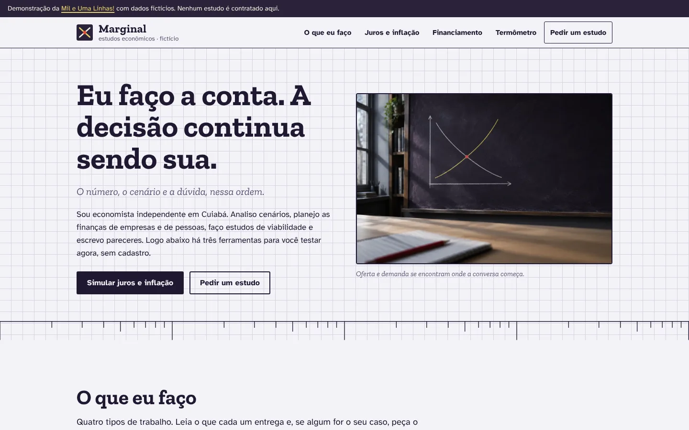
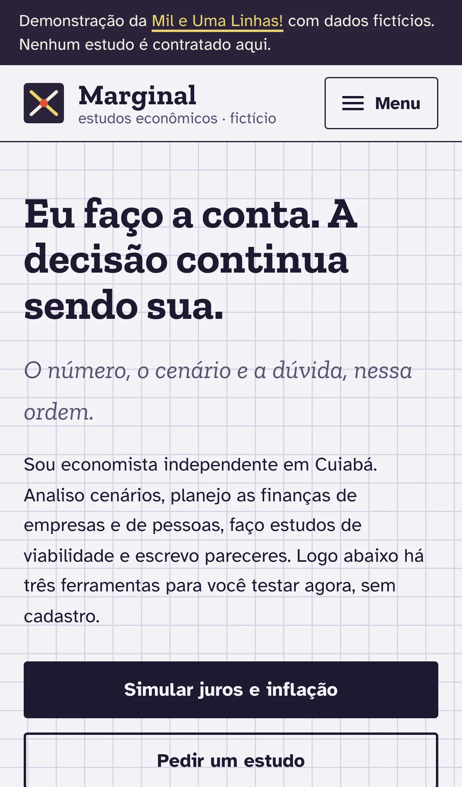
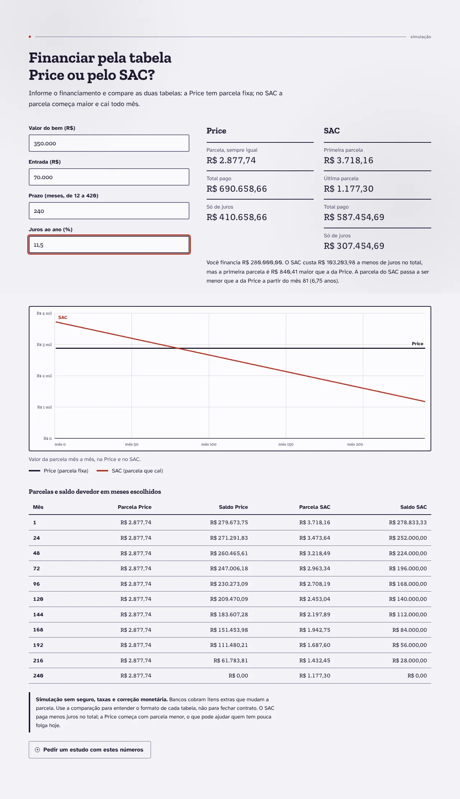
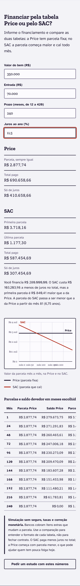
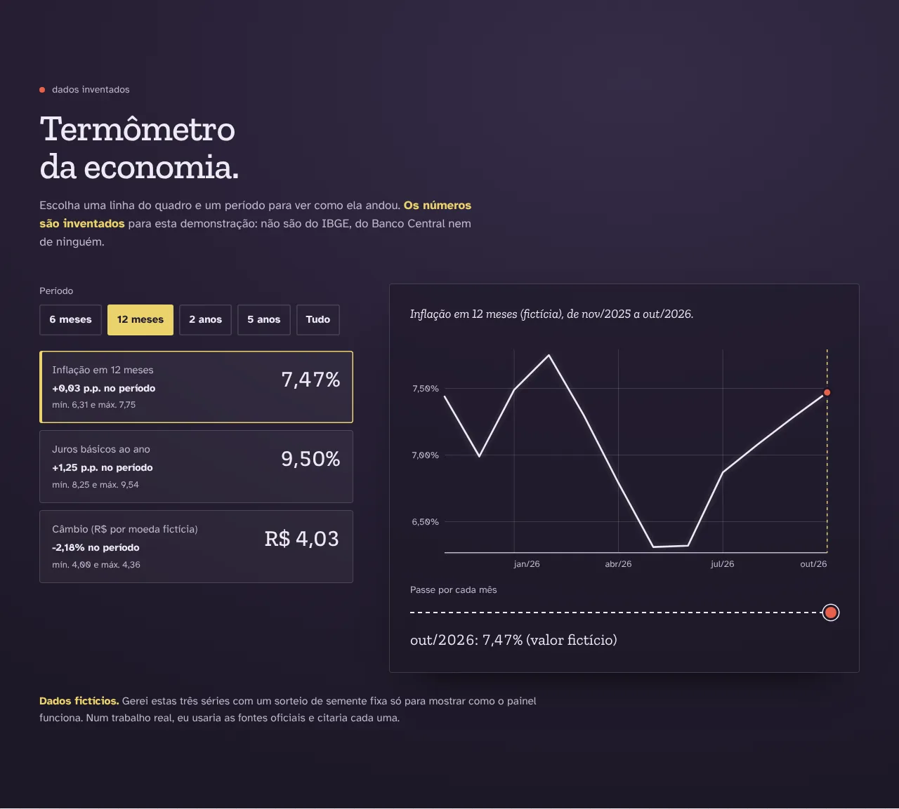
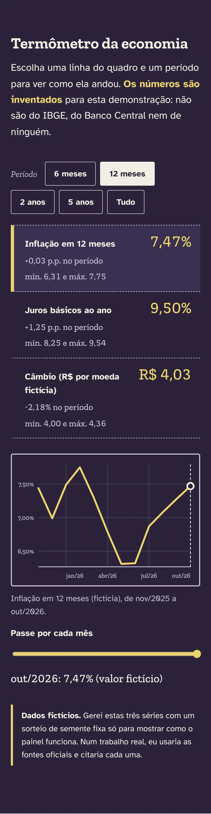
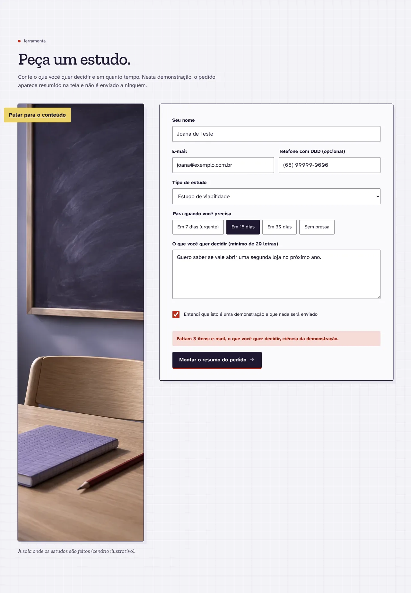
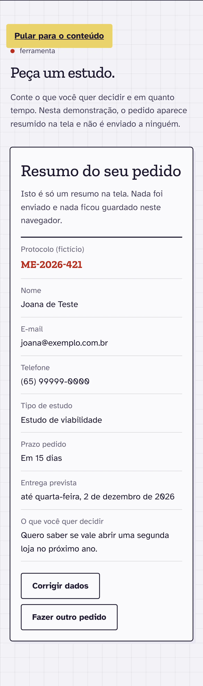

# Marginal Estudos Econômicos (demonstração)

Oi, eu sou o Rodrigo Jr, da [Mil e Uma Linhas!](https://mileumalinhas.com.br). Este site é uma **demonstração** que eu fiz para mostrar a economistas, consultores e analistas financeiros o que um site de verdade pode fazer por eles. A empresa, a economista, o endereço, o telefone, os preços e os números do termômetro são **inventados**. Nada aqui é vendido, cobrado ou enviado.

Endereço quando publicado: https://toshiro01001.github.io/economista/

## O que o site é

Um site de uma economista independente fictícia em Cuiabá. Ele não só apresenta os serviços: ele deixa o visitante **testar** três ferramentas e pedir um estudo, tudo na própria página.

## Como usar, em passos

1. Abra o site. No quadro de giz do topo, passe o mouse sobre o gráfico ou arraste a régua "Mexa na demanda": o preço de equilíbrio muda na hora. Em "O que eu faço" estão os quatro serviços.
2. Em **Juros e inflação**, preencha o quanto tem, o quanto guarda por mês, o prazo, o rendimento e a inflação. O gráfico mostra o saldo nominal e o saldo em reais de hoje.
3. Em **Financiamento**, informe valor, entrada, prazo e juros. Veja as duas tabelas, Price e SAC, com gráfico e tabela de parcelas.
4. No **Termômetro**, escolha o período e a série (inflação, juros ou câmbio). Todos os números são inventados.
5. Em **Pedir um estudo**, preencha o formulário. O resumo aparece na tela. Nada é enviado.

## Capturas

| Computador | Celular |
|---|---|
|  |  |
|  |  |
|  |  |
|  |  |
|  |  |

## Identidade visual, em resumo

Em 17/11/2026 o site foi refeito em React, com WebGL, no Padrão Premium da Mil e Uma Linhas!. A identidade continua a mesma do começo, só que levada a sério: **quadro de giz e papel quadriculado**. Nada de moeda dourada, azul de banco ou gráfico subindo para sempre.

- **Quadro de giz vivo:** a primeira tela é uma lousa desenhada em WebGL, com marcas de apagador e grão. As curvas de oferta (giz amarelo) e de demanda (giz branco) são riscadas ao abrir. Passar o mouse sobre o gráfico, ou arrastar a régua "Mexa na demanda", desloca a demanda: o ponto de equilíbrio anda, e o preço e a quantidade mudam na hora. A demanda de antes fica como um fantasma apagado. O mercado é de exemplo, com números inventados.
- **Cores:** lousa ameixa `#282136`, giz `#EEEAF4`, giz amarelo `#EBD36B`, papel lilás claro `#F3F2F7`, tinta violeta `#1F1830` e um único destaque, o lápis vermelho `#B82E1D` (`#E9614B` sobre a lousa).
- **Ritmo:** lousa no topo, no termômetro e no rodapé; papel quadriculado nos serviços, nos dois simuladores e no pedido.
- **Fontes:** Zilla Slab (títulos e números, com cara de caderno de séries) e Atkinson Hyperlegible (texto, feita para ler fácil, com o zero cortado). As duas são livres (SIL OFL) e vão dentro do próprio site.
- **Movimento:** o giz que desenha as curvas, os títulos que sobem por linha, as duas fitas de termos econômicos em sentidos opostos e o cabeçalho que se esconde ao descer e volta ao subir. Com "reduzir movimento" tudo nasce pronto e o quadro fica parado.
- **Assinatura:** o rodapé leva a assinatura M1L! | RTJ, com o RTJ vivo.
- **Fotos:** todas geradas por IA no Canva na versão anterior e ilustrativas. Nenhuma foto nova foi gerada. Para uma economista real, o caminho é fotografar a mesa, o quadro e a sala de verdade.
- Estudo completo em [`docs/identidade.md`](docs/identidade.md).

## Como funciona por dentro

Seu navegador faz todas as contas sozinho. O quadro do topo resolve onde a oferta e a demanda se cruzam e desenha o resultado. O simulador calcula mês a mês: aplica o rendimento, soma o que você guardou e desconta a inflação para dizer quanto aquele dinheiro compra em reais de hoje. O comparador monta as tabelas Price (parcela fixa) e SAC (amortização fixa, parcela caindo). O termômetro lê três séries inventadas guardadas no site e desenha a do período escolhido. O pedido confere os campos e mostra o resumo. Nada sai do navegador e nada fica guardado.

## Onde está cada coisa

- `index.html`: a página. Ela carrega um arquivo de programa e uma folha de estilo de `assets/` (os nomes mudam a cada compilação).
- `assets/`: o programa compilado (React), o estilo e as fontes. São arquivos compilados: não edite à mão.
- `img/`: as fotos e a assinatura.
- `404.html`, `404.css` e `fonts/zilla-slab-500.woff2`: a página de erro, que não usa script.
- `licencas/`: as licenças do React, do Lenis e das duas fontes.
- `tests/site.cjs`: os testes. `docs/`: capturas, identidade e vistoria.

O código-fonte fica no repositório privado `mil-e-uma-linhas-conteudo`, em `vitrines-fonte/marginal-giz/`. Lá, `node publicar.mjs` compila e copia a página pronta para este repositório.

## Detalhes técnicos

- React 18 e Lenis (rolagem suave), compilados com Vite. Sem CDN, sem analytics, sem fonte externa.
- O quadro de giz é um shader em WebGL2 puro, sem biblioteca, escrito para este site. Ele pausa quando sai da tela e tem um fiscal de fluidez: se o aparelho não acompanha, o quadro para de se mexer sozinho e só redesenha quando alguém mexe. Sem WebGL2 aparece a foto da lousa.
- As curvas do quadro: oferta `0,10 + 0,78·q^1,35` e demanda `0,05 + 0,88·(1 − (q − s))^1,7`, com o equilíbrio achado por bisseção. As mesmas fórmulas estão no shader e no programa, para o texto bater com o desenho.
- Juros compostos com taxa mensal equivalente `(1+i)^(1/12)-1`, aporte no fim do mês, aporte corrigido pela inflação uma vez por ano (opcional) e valor real `nominal / (1+inflação mensal)^meses`.
- Price: `PMT = PV*i / (1-(1+i)^-n)`. SAC: amortização `PV/n` e juros sobre o saldo.
- Gráficos de linha em SVG, redesenhados quando a largura muda. Séries fictícias de 118 meses, semente fixa 430.
- Content-Security-Policy por meta: `default-src 'self'`, sem script inline, `connect-src 'none'`, `form-action 'none'`.

## Como rodar

Não precisa instalar nada. Na pasta acima deste projeto:

```
python3 -m http.server 8320
```

e abra http://127.0.0.1:8320/economista/ no navegador.

## Testes

Com o Playwright instalado, na raiz do projeto: `node tests/site.cjs`. O script sobe o servidor, abre o site em 1280x900, iPhone 13 e 320px, confere as contas (casos com resposta conhecida), as validações, o termômetro, o pedido, o console, a rolagem horizontal e os textos cortados. Com `CAPTURAS=1` ele também salva as imagens.

## Segurança

Política de segurança de conteúdo restritiva, nenhum envio de dados, nada em `localStorage`. As bibliotecas (React e Lenis) vão compiladas dentro do próprio site. Detalhes em [`docs/vistoria.md`](docs/vistoria.md).

## Quer um site assim?

Fale com a [Mil e Uma Linhas!](https://mileumalinhas.com.br).
